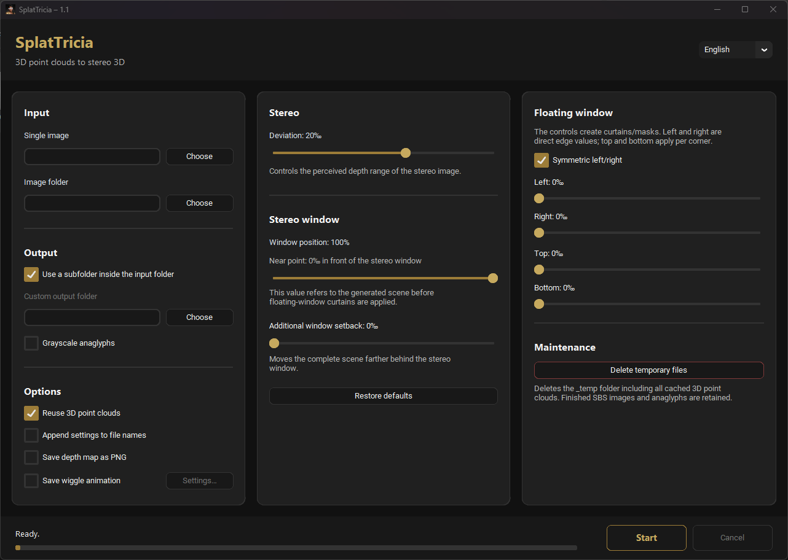

# SplatTricia 1.1 — development preview

This branch contains the 1.1 test version. The [stable 1.0](https://github.com/muelli1975/SplatTricia/releases/tag/v1.0) remains available.

[Deutsch](README_DE.md)

SplatTricia is a local Windows tool for automatically converting individual 2D images or complete image folders into stereo 3D. Each image produces a parallel side-by-side stereo image (SBS) and either a colour or grayscale anaglyph.

The 3D reconstruction is based on **Apple SHARP**. SplatTricia processes images locally, performs no automatic model downloads, and does not require cloud or online services for normal use.

## Requirements

- Windows 10 or 11
- compatible NVIDIA graphics card with a current driver
- locally supplied SHARP checkpoint at `models\sharp_2572gikvuh.pt`

The SHARP checkpoint is **not part of SplatTricia** and is not provided in this repository. Apple's model license terms apply.

## Basic use

1. Select a single image or an image folder.
2. Use an output folder beside the input or select a custom output folder.
3. Set the desired deviation and stereo-window position.
4. Add floating-window curtains when required.
5. Select colour or grayscale anaglyph output.
6. Click **Start**.

## Stereo controls

**Deviation** controls the horizontal depth range of the generated stereo scene. **Stereo-window position** determines how that depth is distributed relative to the picture plane. The additional window backshift is available only at a window position of 100%. **Floating-window curtains** mask edge areas without changing the scene geometry itself.

Automatic 2D-to-3D conversion remains a geometric estimate. For projection or other demanding uses, deviation, window placement and image edges should be checked visually.

## Optional exports in 1.1

- **Save depth map as PNG:** 16-bit relative inverse depth, white near/black far, from the original central view. Saved under `depth_maps`, matching the processed single-image dimensions. Stereo controls and curtains do not alter it.
- **Save wiggle animation:** saved under `wiggle`. **Settings…** opens the themed editor for format, maximum image size, frame rate and cycle duration. Image size and frame rate are remembered separately per format; cycle duration is shared.
- MP4: H.264 CRF18/slow, 8-bit 4:2:0, 30/60 fps, maximum 720/1080/2160 pixels high, five cycles.
- GIF: 10/15/20/25 fps (default: 15 fps), maximum 800 pixels on the long edge by default, endless loop.
- PNG sequence: 30/60 fps, maximum 1080/2160 pixels high, one numbered cycle per source image.

The default cycle takes two seconds. Images are never enlarged. Wiggle reuses the existing deviation/window placement and cached PLY; floating-window curtains are not applied. The depth and animation options are off by default.

## Output

The selected output location contains:

- `sbs`: parallel side-by-side stereo images
- `anaglyph`: colour or grayscale anaglyphs
- `_temp`: cached PLY point clouds and validation data

Valid PLY files can be reused, allowing stereo settings to be rendered again without running SHARP a second time. **Delete temporary files** removes only `_temp`; finished images remain untouched.

Existing output images are replaced without prompting. **Append settings to filename** can be used to keep deliberately created variants side by side.

Where technically possible, SplatTricia copies metadata from suitable source files to the finished JPEG outputs.

## Source code and long-term use

This repository contains the SplatTricia source code together with build notes, a release checklist, and documented design, state and folder conventions. The aim is to keep the program understandable and usable for future development and for the stereoscopic community.

Active maintenance, support, issue handling or pull-request review cannot be guaranteed.

SplatTricia source code and original documentation created by Christoph Müller are licensed under the **MIT License**. SHARP and all other third-party components remain subject solely to their respective licenses.

## Windows download and setup

Download all three ZIP files from the [SplatTricia 1.1 release](https://github.com/muelli1975/SplatTricia/releases/tag/v1.1-preview1):

- `SplatTricia_1.1.zip` — application, tools, documentation and licenses
- `SplatTricia_1.1_Runtime_1.zip` — runtime libraries, part 1
- `SplatTricia_1.1_Runtime_2.zip` — runtime libraries, part 2

1. Extract **every ZIP into the same destination directory**, merging their shared `SplatTricia` subfolder. Do not extract them into separate folders named after each archive.
2. Obtain the SHARP checkpoint yourself from [Apple's official project](https://github.com/apple-aiml-research/ml-sharp). Read and accept Apple's model terms before downloading.
3. Place `sharp_2572gikvuh.pt` in `SplatTricia\models`.
4. Start `SplatTricia\SplatTricia.exe`.

All runtime libraries are included. No separate Python installation, CUDA toolkit or build tools are required. Processing works offline after setup.

The native runtime libraries are reused from 1.0. This preview is awaiting visual assessment on an NVIDIA GPU. `SplatTricia_1.1_SHA256SUMS.txt` provides checksums for all three ZIPs.
